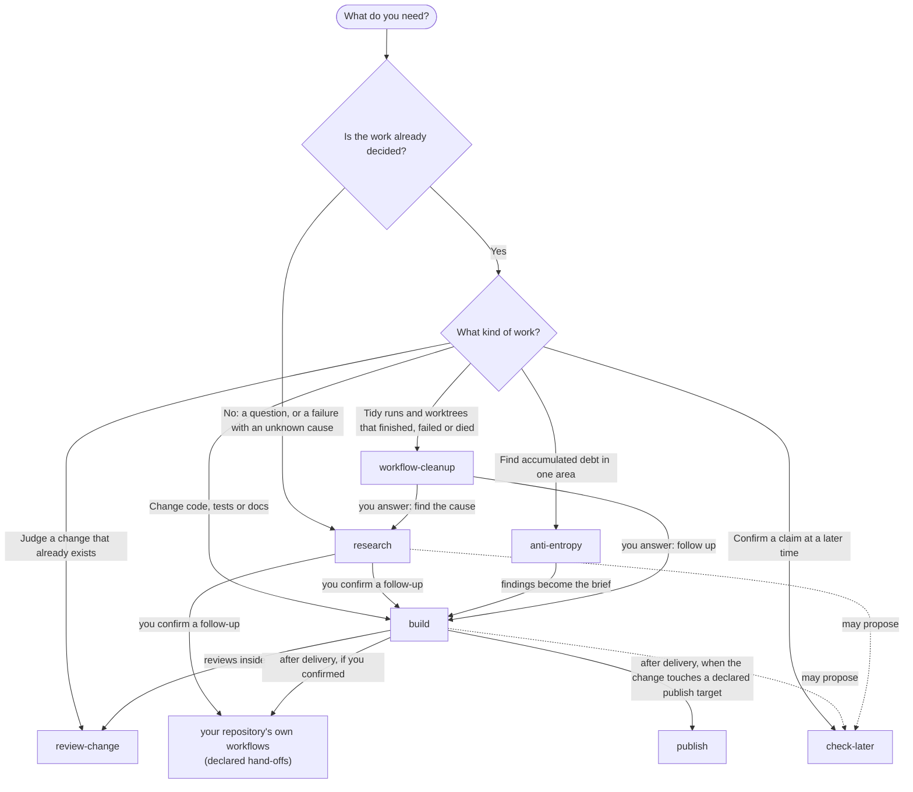

# Archon kit

The Archon kit is a set of seven workflows for [Archon](https://github.com/coleam00/Archon), the tool that runs AI coding agents as YAML graphs, together with the scripts they call and a command, `archon-kit`, that sets a repository up for them. The workflows plan, test, implement and review a change (`build`), research a question (`research`), review a finished change (`review-change`), look for accumulated debt (`anti-entropy`), re-check a claim later (`check-later`) and tidy the runs and worktrees that other runs leave behind (`workflow-cleanup`) and publish a declared target such as a docs site (`publish`). Each one pauses for a person at the points where a decision belongs to a person, and shows the report as a web page.

The kit runs on Claude or Codex. Every workflow names a model tier, so one switch moves all of them to the other provider.

## Prerequisites

| Tool | Version | Needed for |
| --- | --- | --- |
| `archon` | 0.13.2 | Running workflows. Other versions are untested. |
| `bash`, `git`, `jq`, `python3` | bash 3.2, git 2.31, jq 1.6, python3 3.7 with `sqlite3` | Every script. macOS ships bash 3.2, and the scripts need nothing newer. |
| `node` | 20 or later, and 22.13 for the kit's own tests | The lane hook and the tests, even when your project is not JavaScript. |
| `flock` | any | `build`, `review-change` and `publish`, and every step that writes a report page. On macOS, `brew install flock`. |
| `timeout` | GNU coreutils, and `gtimeout` works too | The report and screenshot steps of `build`, `research`, `anti-entropy` and `workflow-cleanup`. On macOS, `brew install coreutils`. |
| `realpath` and `readlink -f` | GNU coreutils or a recent BSD | Report links and `worktree-land`. On macOS, `brew install coreutils` and put its `gnubin` directory first on `PATH`. |
| `curl` | any | `archon-kit reports up` and `reports status`. |
| `claude` or `codex` | current | A provider for the agent nodes. |
| `gh` | any | Needed when `build` runs with `deliver` set to `draft-pr`. Otherwise optional: without it a branch with an open pull request reads as pushed. |
| PyYAML, `markdown-it-py` | any | Optional. The first checks the workflow schemas in the tests, the second makes report pages nicer. |

`archon-kit doctor` checks each of these. [Dependencies](docs/reference/dependencies.md) lists every other tool the kit calls, what happens when one is missing and the parts of Archon that the kit reads.

## Quickstart

1. Clone this repository and install it. The installer copies the workflows, scripts and profiles into `~/.archon` (or `$ARCHON_HOME`), links `archon-kit` into `~/.local/bin`, and records what it installed so that `uninstall.sh` removes only that.

   ```bash
   git clone https://github.com/echo-bravo-yahoo/archon-kit
   cd archon-kit
   ./install.sh
   ```

2. Set up the repository you want to work in. This adds `.archon/` declarations, registers the lane hook and adds the report instructions to `CLAUDE.md` and `AGENTS.md`.

   ```bash
   archon-kit init-repo ~/projects/my-repo
   ```

3. Edit `.archon/gates.json` to list the commands that decide whether a change ships, commit `.archon/`, push it, and check the result. A run's worktree is cut from `origin/<branch>`, so a declaration that is not pushed is not seen. A run's worktree has no installed dependencies, so for a project that has them, start each gate set with the project's install command (for example `npm ci`) as the first entry in `ordered`, and put the commands that need the installed packages after it. `parallel` runs before `ordered`, so it suits only commands that need no install.

   ```bash
   archon-kit doctor ~/projects/my-repo
   ```

4. Start the report server, which serves the HTML pages that runs write, on localhost.

   ```bash
   archon-kit reports up
   ```

5. Run a workflow from inside the repository.

   ```bash
   cd ~/projects/my-repo
   archon workflow run research "Why does the nightly export time out?"
   ```

Switching providers is one command, `archon-kit provider use codex`, or `archon-kit run codex <workflow>` for a single run. [Providers](docs/providers.md) lists the differences.

## Choosing a workflow



[Choosing a workflow](docs/choosing-a-workflow.md) repeats the diagram as a table and says when each workflow applies.

## Documentation

- [Choosing a workflow](docs/choosing-a-workflow.md) says which workflow to start with and where each one ends.
- [Extending the kit](docs/extending.md) shows how a repository adds its own workflows, how `research`, `build` and `workflow-cleanup` hand work to them, and how to describe them to `workflow-cleanup`.
- [Providers](docs/providers.md) covers Claude and Codex: the install default, per-run profiles, per-node aliases and what differs on Codex.
- [Testing the kit on Codex](docs/codex-beta-test.md) is a step-by-step guide for a person who has Codex and runs the lane-hook probe, which records what the kit cannot learn without the provider.
- [Reports](docs/reports.md) covers the report server and the report links in pause messages.
- [Telling your agents about reports](docs/agents/reports.md) explains the instruction block that `archon-kit agent-docs` adds.
- [workflow-cleanup](docs/reference/workflow-cleanup.md) and [recovering runs](docs/reference/recovering-runs.md) describe how the cleanup workflow decides, and how to recover a run whose owner process died.
- [Build pauses and the base check](docs/reference/build-pauses.md) says why a run ends at once when a gate is red on its base commit, what each pause of the build loop offers, why a run fails after five rounds that do not pass, and how `archon-kit run-sync` brings a fix into a waiting or failed run.

## License

The kit is released under the [MIT License](LICENSE).

## Working on the kit

`CLAUDE.md` describes the repository layout and the checks to run before a change lands. The tests run with `node --test test/*.test.mjs`.
