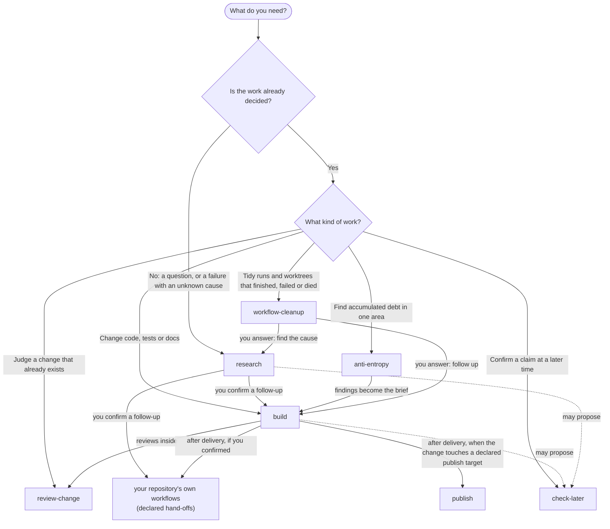

# Choosing a workflow

This page helps you pick the workflow to start with. It lists the seven workflows of the kit, when each one applies and where each one ends, and shows which of them start others.

The diagram shows one box for a repository's own workflows. A repository can declare any number of them, as [Extending the kit](extending.md) explains.

## The workflows

| Workflow | Use it when | It ends at |
| --- | --- | --- |
| `research` | A question needs an answer before anyone decides whether there is work in it, or something fails and the cause is unknown. | A report, then your answer: close it, send the research another round with a note, which rewrites the report when the note is about its shape and extends it when the note asks for more, and either way changes the sections the note bears on and adds a line to the report's `Rounds` history, or start the follow-up workflows it proposed (up to five, one per conceptual task). |
| `build` | The work is decided: you state it in a message or a brief, or a design was approved. A brief's `## Scope of this run` section decides what a run does. | The commits on local `main`, or a draft pull request when `deliver` is `draft-pr`, then the follow-ups you confirmed. |
| `review-change` | A finished change on a branch needs a read before a person sees it. | A verdict, `clean` or `blocked`, and a report. |
| `anti-entropy` | You want to know what debt has accumulated in one area's tests, docs or structure. | Nothing when it finds none, or a pause with the findings that you can turn into a `build` run. |
| `check-later` | A claim can only be confirmed later, such as that a fix held or a migration finished. The run waits for its instant only while something calls `archon workflow wake`, which [Scheduled waits](reference/dependencies.md#scheduled-waits) sets up. | Nothing when the claim holds, or an attention item when it does not. |
| `publish` | A repository declares a publish target in `.archon/build.json` and a change to its paths has landed, or you want the target published now. A `build` run starts it itself when its change touches the target's `auto_paths`. | The target's `command` has run and its `check`, when it has one, has passed. |
| `workflow-cleanup` | Runs have piled up, or one died. | Nothing for runs that saved their work, a rescued or handed-off run, or a pause for a failure that needs you. |

## How the workflows start each other

`research` proposes follow-ups. At its pause you choose whether they start, and each one receives your note and the research report as its brief. The candidates are `build` in this repository or in another one that passes `build`'s start-up checks, the workflows the repository declares as hand-offs, global hand-offs from `kit.json`, and `check-later`. Before it names another repository, the researcher lists the tracked files of this repository and of the candidate; a path that this repository tracks stays here even when its first directory has the name of a candidate. A run reads the tip of the local base branch, so work that landed there and was never pushed is part of what it reads.

Your steering comes first when work is divided. Without it, one run is one conceptual task, however many files it touches. A brief with several tasks takes the one its `## Scope of this run` section names, and the plan lists the others as left for separate runs. A task that spans several repositories gets one follow-up entry for each repository, because a `build` lands only the repository it runs in.

`build` can propose hand-offs of its own to start after it delivers, such as a deploy. You confirm them at the plan gate. A plan that produces something no declared hand-off puts live, such as a built page that nothing publishes, fails at the plan stage unless it proposes a `build` hand-off that adds the missing workflow. A `build` run also starts `publish` by itself when its change touches the paths of a declared publish target, and it fails when a hand-off cannot start.

`anti-entropy` starts a `build` run with its findings as the brief when you approve.

`workflow-cleanup` pauses on a failure that needs a person and recommends one answer. `research` finds the cause, and `follow-up` starts the workflow its report names, chosen from the same candidates that `research` offers.

`build` includes `review-change` as its reviewer, so the review prompt lives in one place.

## Before the first run

A workflow runs only in a repository that declares what it reads. `archon-kit init-repo` writes the declarations, and `archon-kit doctor <repository>` checks them. The README's quickstart lists the steps.